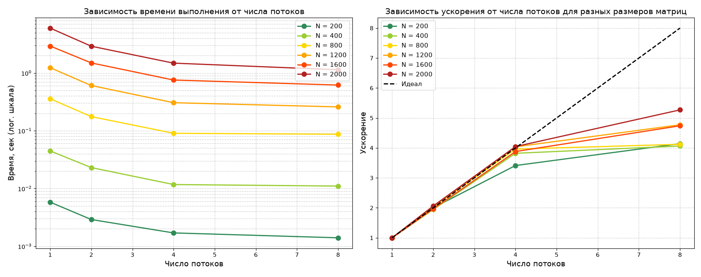

# Лабораторная работа №2
## 1. Задание
Модифицировать программу из л/р №1 для параллельной работы по технологии OpenMP. Провести серию экспериментов с разным количеством потоков (1, 2, 4, 8 и т.д.), разными размерами матриц (примерно 200, 400, 800, 1200, 1600, 2000), с разным количеством вычислительных ядер при наличии технической возможности (1, 2, 4, 8 и т.д. ), иначе использовать фиксированное существующее количество вычислительных ядер, например 4.
## 2. Структура
- `tests.py` - Программа на Python, создающая два txt файла квадратных матриц со случайными числами в диапазоне (0-9) и размером на первой строке, запускающая `multmatrixOMP.exe`, проверяющая результат умножения с помощью NumPy и повторяющая эти действия для каждого из размеров матриц (200, 400, 800, 1600, 2000)
- `multmatrixOMP.cpp` - Программа на C++, читающая два txt файла квадратных матриц, умножающая их элементы по циклам `i-k-j` с помощью фиксированного числа потоков, записывающая результат умножения и размер матриц в новый txt файл, а время их умножения и число потоков в файл `results.txt`
- `results.txt` - Файл, создаваемый программой `multmatrixOMP.exe`, включающий результаты измерений: размеры матриц, количество потоков и время умножения
- `matrix_a.txt` - Файл, создаваемый программой `tests.py`, включающий размер квадратной матрицы на первой строке и случайные числа в диапазоне (0-9) на остальных строках
- `matrix_b.txt` - Файл, создаваемый программой `tests.py`, включающий размер квадратной матрицы на первой строке и случайные числа в диапазоне (0-9) на остальных строках
- `matrix_c.txt` - Файл, создаваемый программой `multmatrixOMP.exe`, включающий размер квадратной матрицы на первой строке и результаты умножения исходных матриц на остальных строках
- `plots.py` - Программа на Python, создающая график зависимости времени умножения от размера матриц и количества потоков
- `plots_2.png` - Изображение графиков, созданное программой `plots.py`
## 3. Изменения в реализации
### 3.1 `multmatrixOMP.cpp`
- Добавлен заголовок `#include <omp.h>`, константа `const int NUM_THREADS`, вызов `omp_set_num_threads(NUM_THREADS)` и директива `#pragma omp parallel for` перед внешним циклом по `i`
- Добавлен заголовок `#include <iomanip>` для фиксированного вывода и `setprecision(4)`
- Запись результатов в формате `Size: NxN | Threads: N | Time: N sec` в файл `results.txt` вместо консоли
- Переменная `double bestTime` содержит наименьшее время из 5 прогонов и записывает его в `results.txt`
### 3.2 `tests.py`
- Объединяет в себе функции из файлов `generate.py` и `verify.py`
- Добавлен `import subprocess` для запуска `.exe` из Python
- Переменная `EXE` содержит название файла с расширением`.exe`
- Переменная `SIZES` содержит размеры матриц, с которыми будут проводиться измерения
- Переменная `all_ok` для отслеживания успешности всех проверок
- Добавлена функция `run_cpp()` для запуска `.exe`
- Добавлены проверки успешного запуска `.exe`
- Файл `verify.py` переделан в функцию `verify()`, возвращающую True/False вместо записи в консоль
- Цикл `for n in SIZES` для запуска генерации, `.exe` и проверки для всех размеров матриц из `SIZES`
- Вывод размера матриц, результата каждой верификации и итога всех верификаций в конце
## 4. Использование
1. В переменной `const int NUM_THREADS` в `multmatrixOMP.cpp` задаём нужное количество потоков
2. Собираем решение в Visual Studio в конфигурации `Release | x64`, помещаем полученный `.exe` в папку с программой `tests.py`
3. Запускаем `tests.py`, через консоль убеждаемся в успешном прохождении всех верификаций
4. Открываем файл `results.txt`, изучаем результаты измерений
## 5. Результаты замеров
| N | 1 поток | 2 потока | 4 потока | 8 потоков |
|:-:|:-:|:-:|:-:|:-:|
| 200 | 0.0058 | 0.0029 | 0.0017 | 0.0014 |
| 400 | 0.0447 | 0.0230 | 0.0117 | 0.0110 |
| 800 | 0.3577 | 0.1755 | 0.0903 | 0.0868 |
| 1200 | 1.2332 | 0.6060 | 0.3055 | 0.2584 |
| 1600 | 2.9249 | 1.4914 | 0.7541 | 0.6172 |
| 2000 | 5.9836 | 2.9039 | 1.4793 | 1.1355 |

Замеры проводились в конфигурации `Release`, автоматически выводились наилучшие результаты среди пяти в цикле. Верификация запускалась автоматически после каждой серии замеров
## 6. Расчёты
Теоретическая сложность алгоритма O(N³) не зависит от числа потоков: распараллеливание уменьшает константу, но не порядок роста. Для оценки эффективности увеличения числа потоков, рассчитаем теоретическое и фактическое ускорение. Эффективность показывает, какая доля теоретического максимума достигнута

| N | Потоки | Теор. ускорение | Факт. ускорение | Эффективность |
|:-:|:-:|:-:|:-:|:-:|
| 200 | 2 | 2.00 | 2.00 | 100% |
| 200 | 4 | 4.00 | 3.41 | 85% |
| 200 | 8 | 8.00 | 4.14 | 52% |
| 400 | 2 | 2.00 | 1.94 | 97% |
| 400 | 4 | 4.00 | 3.82 | 96% |
| 400 | 8 | 8.00 | 4.06 | 51% |
| 800 | 2 | 2.00 | 2.04 | 102% |
| 800 | 4 | 4.00 | 3.96 | 99% |
| 800 | 8 | 8.00 | 4.12 | 52% |
| 1200 | 2 | 2.00 | 2.03 | 102% |
| 1200 | 4 | 4.00 | 4.04 | 101% |
| 1200 | 8 | 8.00 | 4.77 | 60% |
| 1600 | 2 | 2.00 | 1.96 | 98% |
| 1600 | 4 | 4.00 | 3.88 | 97% |
| 1600 | 8 | 8.00 | 4.74 | 59% |
| 2000 | 2 | 2.00 | 2.06 | 103% |
| 2000 | 4 | 4.00 | 4.04 | 101% |
| 2000 | 8 | 8.00 | 5.27 | 66% |

- 2 потока: эффективность 97-103%, то есть ускорение практически линейное
- 4 потока: эффективность 85-101%, небольшие потери на малых N из-за накладных расходов
- 8 потоков: эффективность 51-66%, что объясняется законом Амдала и конкуренцией за пропускную способность памяти
## 7. Графики

На втором графике видно, что при 2 потоках достигается наименьшее отклонение фактического ускорения от теоретического (идеального)
## 8. Выводы
1. OpenMP не меняет алгоритмическую сложность: распараллеливание уменьшает константу (абсолютное время), но сохраняет кубический характер роста
2. На 2 потоках ускорение ~ 2.0x (эффективность 97-103%) - накладные расходы OpenMP минимальны, наиболее эффективно
3. На 4 потоках достигается максимальное ускорение ~ 4.0x (эффективность 85-101%), наилучший вариант по соотношению скорости/эффективности
4. На 8 потоках ускорение 4.1-5.3x (эффективность 51-66%) - рост числа потоков сверх 4 не даёт пропорционального выигрыша, наименее эффективный вариант среди представленных
5. Основные ограничения масштабирования: закон Амдала (последовательная доля кода ~2-5%), конкуренция потоков за пропускную способность RAM и накладные расходы OpenMP
