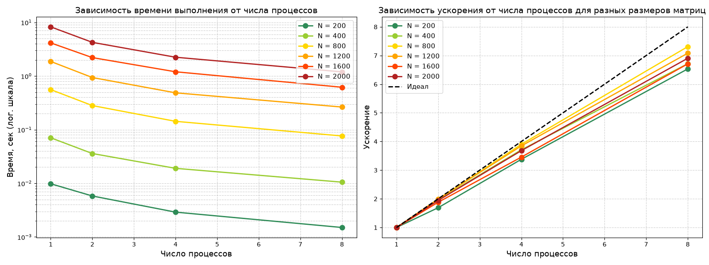

# Лабораторная работа №3
## 1. Задание
Модифицировать программу из л/р №1 для параллельной работы по технологии MPI. Провести серию экспериментов с разными размерами матриц (примерно 200, 400, 800, 1200, 1600, 2000), с разным количеством вычислительных ядер (1, 2, 4, 8 и т.д.).
Параллельную версию программы на MPI необходимо запустить на суперкомпьютере «Сергей Королёв»
## 2. Структура
- `generate.py` - Программа на Python, создающая два txt файла квадратных матриц по заданному размеру со случайными числами в диапазоне (0-9) и размером на первой строке
- `multmatrixMPI.cpp` - MPI программа на C++, читающая два txt файла квадратных матриц, умножающая их элементы по циклам `i-k-j` с помощью заданного числа процессов, записывающая результат умножения и размер матриц в новый txt файл, а время их умножения, число процессов и результат проверки в файл `timing.txt`
- `job.sh` - скрипт SLURM для запуска MPI-программы умножения матриц на кластере с перебором числа процессов (1, 2, 4, 8) и размеров матриц (200-2000)
- `verify.py` - Программа на Python, читающая исходные txt файлы квадратных матриц, умножающая их с помощью библиотеки NumPy и сравнивающая получившийся результат с результатом программы на C++, выводя результат сравнения
- `timing.txt` - Файл, создаваемый программой `multmatrixMPI`, включающий результаты измерений: размеры матриц, количество потоков и время умножения
- `matrix_a.txt` - Файл, создаваемый программой `generate.py`, включающий размер квадратной матрицы на первой строке и случайные числа в диапазоне (0-9) на остальных строках
- `matrix_b.txt` - Файл, создаваемый программой `generate.py`, включающий размер квадратной матрицы на первой строке и случайные числа в диапазоне (0-9) на остальных строках
- `matrix_c.txt` - Файл, создаваемый программой `multmatrixOMP.cpp`, включающий размер квадратной матрицы на первой строке и результаты умножения исходных матриц на остальных строках
- `plotsMPI.py` - Программа на Python, создающая график зависимости времени умножения от размера матриц и количества потоков
- `plotsMPI_2.png` - Изображение графика, созданное программой `plot.py`
## 3. Изменения в реализации
### 3.1 `multmatrixMPI.cpp`
- Добавлен заголовок `#include <mpi.h>` и вызовы `MPI_Init(&argc, &argv)` / `MPI_Finalize()` для инициализации и завершения среды MPI
- Добавлены `MPI_Comm_rank(MPI_COMM_WORLD, &rank)` и `MPI_Comm_size(MPI_COMM_WORLD, &size)` для определения номера текущего процесса и их общего числа
- Добавлен разбор аргумента командной строки `n = atoi(argv[1])` - размер матрицы передаётся при запуске, а не читается из файла; имена файлов формируются как `matrix_a<n>.txt`, `matrix_b<n>.txt`, `matrix_c<n>.txt`
- Чтение матриц `matrix_a<n>.txt` и `matrix_b<n>.txt` выполняется только на процессе rank 0; остальные процессы получают данные через коллективные операции MPI
- Добавлен `MPI_Bcast` для рассылки плоского буфера `Bflat` (матрица B размером `n*n`) от rank 0 всем процессам - каждому нужна вся B для своей полосы C
- Добавлено ленточное разбиение строк матрицы A по процессам: массивы `counts[r]` и `displs[r]` вычисляются по формуле `base = n/size`, `rem = n%size`
- Добавлен `MPI_Scatterv` для раздачи полос строк матрицы A: rank 0 передаёт каждому процессу свой блок `localA` из `counts[rank]` строк, начиная со смещения `displs[rank]`
- Изменена область внешнего цикла умножения: вместо `for (i = 0; i < n; ++i)` используется `for (i = 0; i < counts[rank]; ++i)` - каждый процесс считает только свои строки, результат накапливается в локальном `localC`
- Добавлен пропуск нулевых элементов `if (aik == 0) continue` во внутреннем цикле по `k` - снижает число обращений к B и объём вычислений
- Добавлен `MPI_Gatherv` для сбора локальных полос `localC` со всех процессов в общий буфер `Cflat` на rank 0
- Замер времени переведён на `MPI_Wtime()` с синхронизацией `MPI_Barrier(MPI_COMM_WORLD)` перед стартом - таймер фиксирует время от «все процессы готовы» до завершения `Gatherv`; в интервал входят `MPI_Bcast`, `MPI_Scatterv`, умножение и `MPI_Gatherv`
- Добавлен `MPI_Reduce(MPI_MAX)` - в `timing.txt` записывается максимальное время по всем процессам (время самого медленного), а не время rank 0; это позволяет получить более 
- Добавлена последовательная верификация `verifySequential` на rank 0: эталон `C_ref = A·B` считается тройным циклом (`i-j-k`, сумма в `long long`), сравнивается поэлементно с `C`; результат пишется как `check=OK/FAIL`, для `n > 800` - `check=SKIP` (порог `VERIFY_MAX_N = 800`)
- Добавлен отдельный таймер вокруг верификации (`vstart`/`vend`) - время проверки пишется в колонку `verify_time` и не входит в `time`
- Изменена обработка ошибок: вместо `cerr` и `return 1` используется лямбда `logError`, которая пишет сообщение в `errors.txt` (только rank 0) и вызывает `MPI_Abort(MPI_COMM_WORLD, 1)` для аварийного завершения всех процессов
- Запись результатов в формате `P=N | n=N | time=N sec | check=OK/FAIL/SKIP | verify_time=N sec` в файл `timing.txt` (режим `ios::app`) вместо консоли; ошибки - в `errors.txt`
- Убран цикл `for (int run = 0; run < 5; run++)` - оставлен один прогон на каждую комбинацию `P` и `n`
- Убран вывод в `cout`/`cerr` - весь вывод перенаправлен в файлы `timing.txt`, `errors.txt`, `matrix_c<n>.txt`
- Добавлены плоские буферы `vector<int>` (`Aflat`, `Bflat`, `Cflat`, `localA`, `localC`) вместо `vector<vector<int>>` для корректной передачи через MPI

### 3.2 `generate.py`
Программа взята из первой лабораторной и доработана, чтобы для генерируемых матриц a и b в названии файлов был записан их размер, например `matrix_a200`. Запускается на ПК чтобы подготовить матрицы заранее
### 3.3 `verify.py`
Программа взята из первой лабораторной. Используется на ПК, чтобы проверить результат для больших размеров матриц (1200, 1600, 2000), где внутренняя проверка `multmatrixMPI` отключена для экономии времени и ресурсов суперкомпьютера
## 4. Использование
1. Создать с помощью `generate.py` файлы матриц, назвать их в формате `matrix_a200.txt`, ... , `matrix_a2000.txt`
2. Поместить файлы матриц, `multmatrixMPI.cpp` и `job.sh` в одну директорию
3. Скомпилировать код с помощью `mpiicpc -O2 -std=c++17 multmatrix_mpi.cpp -o multmatrix_mpi`
4. Запустить тест с помощью `sbatch job.sh`, можно проверить статус: `squeue -u $USER`
5. Дождаться выполнения, прочитать файл с результатами: `cat timing.txt`. При необходимости прочитать файлы с ошибками: `errors.txt`, `matrix_errors.err`
## 5. Результаты замеров
| N | 1 процесс | 2 процесса | 4 процесса | 8 процессов |
|:-:|:-:|:-:|:-:|:-:|
| 200 | 0.0098 | 0.0058 | 0.0029 | 0.0015 |
| 400 | 0.0705 | 0.0359 | 0.0190 | 0.0105 |
| 800 | 0.5578 | 0.2811 | 0.1429 | 0.0763 |
| 1200 | 1.8682 | 0.9367 | 0.4857 | 0.2638 |
| 1600 | 4.1433 | 2.2036 | 1.1989 | 0.6175 |
| 2000 | 8.2434 | 4.2410 | 2.2391 | 1.1939 |

Замеры проводились в сборке `Release` благодаря флагу компиляции `-O2`, на размерах матриц <= 800 верификация происходила автоматически на суперкомпьютере, для остальных размеров использовался `verify.py` на ПК
## 6. Расчёты
Теоретическая сложность алгоритма O(N³) не зависит от числа потоков: распараллеливание уменьшает константу, но не порядок роста. Для оценки эффективности увеличения числа потоков, рассчитаем теоретическое и фактическое ускорение. Эффективность показывает, какая доля теоретического максимума достигнута
| N | Потоки | Теор. ускорение | Факт. ускорение | Эффективность |
|:-:|:-:|:-:|:-:|:-:|
| 200 | 2 | 2.00 | 1.68 | 84% |
| 200 | 4 | 4.00 | 3.42 | 85% |
| 200 | 8 | 8.00 | 6.32 | 79% |
| 400 | 2 | 2.00 | 1.96 | 98% |
| 400 | 4 | 4.00 | 3.70 | 93% |
| 400 | 8 | 8.00 | 6.69 | 84% |
| 800 | 2 | 2.00 | 1.98 | 99% |
| 800 | 4 | 4.00 | 3.90 | 98% |
| 800 | 8 | 8.00 | 7.31 | 91% |
| 1200 | 2 | 2.00 | 1.99 | 100% |
| 1200 | 4 | 4.00 | 3.85 | 96% |
| 1200 | 8 | 8.00 | 7.08 | 89% |
| 1600 | 2 | 2.00 | 1.88 | 94% |
| 1600 | 4 | 4.00 | 3.46 | 86% |
| 1600 | 8 | 8.00 | 6.71 | 84% |
| 2000 | 2 | 2.00 | 1.94 | 97% |
| 2000 | 4 | 4.00 | 3.68 | 92% |
| 2000 | 8 | 8.00 | 6.90 | 86% |
- 2 процесса (эффективность 84-100%) - ускорение почти линейное на всех размерах, кроме n=200, где время вычислений (~10 мс) сравнимо с накладными расходами на `MPI_Bcast`, `MPI_Scatterv`/`MPI_Gatherv` и `MPI_Barrier`
- 4 процесса (эффективность 85-98%) - эффективность остаётся высокой благодаря равномерному разбиению строк A, но постепенно снижается с ростом n из-за увеличения доли последовательной части на rank 0 и роста объёма рассылаемой матрицы B
- 8 процессов (эффективность 79-91%) - эффективность заметно падает из-за роста доли коллективных коммуникаций и разделения пропускной способности памяти между 8 ядрами, при этом на n=200 потери максимальны (79%), так как фиксированные накладные расходы MPI сравнимы с малым объёмом вычислений
## 7. Графики

## 8. Выводы
1. MPI не меняет алгоритмическую сложность: распараллеливание уменьшает константу (абсолютное время), но сохраняет кубический характер роста
2. На 2 процессах ускорение ~ 1.7-2.0x (эффективность 84-100%) - накладные расходы на `MPI_Bcast` и `MPI_Scatterv` минимальны, достигается наиболее эффективное масштабирование (кроме n = 200, где время вычислений сравнимо с коммуникациями)
3. На 4 процессах ускорение 3.4-3.9x (эффективность 85-98%) - наилучший вариант по соотношению скорости/эффективности для средних и больших матриц (n=800-2000) за счёт равномерного разбиения строк и невысокой доли коммуникаций
4. На 8 процессах ускорение 6.3-7.3x (эффективность 79-91%) - на малых размерах (n = 200) эффективность падает максимально (79%), так как фиксированные расходы на `MPI_Bcast`, `MPI_Gatherv` и `MPI_Barrier` становятся сопоставимы с объёмом вычислений; на больших (n=800-1200) эффективность остаётся высокой (89-91%)
5. Основные ограничения масштабирования: закон Амдала (последовательная доля: чтение файлов, запись результата), накладные расходы на коллективные коммуникации и конкуренция процессов за пропускную способность памяти и кэш при 8 процессах на одном узле
